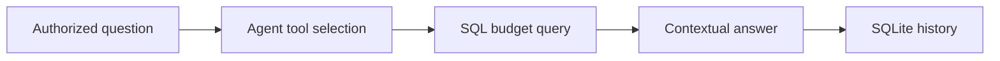

# Budget Assistant for Telegram

A conversational budgeting assistant with tool-based SQL queries and local conversation history.

**Python, Telegram Bot API, OpenAI SDK, pyodbc, SQL Server, SQLite**

## What it does

- Routes authorized Telegram questions through an agent loop and structured tools.
- Queries budget data through a SQL client rather than inventing numerical answers.
- Retains conversation history in SQLite and loads the application prompt from `skills/CloseClawdio`.

## Workflow



## Local setup and use

```powershell
python -m venv .venv
.venv\Scripts\Activate.ps1
python -m pip install -r requirements.txt
python -m src.main
```
Python 3.11+ is recommended. Tkinter requires a desktop Python installation.
Install the Microsoft ODBC driver appropriate to your OS. Configure `.env` from the example with a read-only database account and an explicit Telegram allowlist.

## Configuration

Environment names declared by the included examples (values must be supplied locally):

`OPENAI_API_KEY`, `OPENAI_MODEL`, `SQL_DATABASE`, `SQL_DRIVER`, `SQL_PASSWORD`, `SQL_SERVER`, `SQL_TRUSTED_CONNECTION`, `SQL_USER`, `TELEGRAM_ALLOWED_USERS`, `TELEGRAM_BOT_TOKEN`.

## Boundaries and limitations

Database schemas and query assumptions must match an authorized environment. No database records or provider credentials are distributed. Model answers require review. The bundled skill folder is runtime prompt data for this application.

This is a source snapshot, not a claim of production readiness. Business results, dates and unmeasured performance are intentionally not asserted. Application UI language is preserved.

## License

No new distribution license is granted for this corporate source edition. Public visibility does not grant reuse rights; obtain permission from the relevant rights holder. Existing third-party notices remain applicable.

## Verification record

See [snapshot checks and remaining limitations](docs/VERIFICATION.md).
